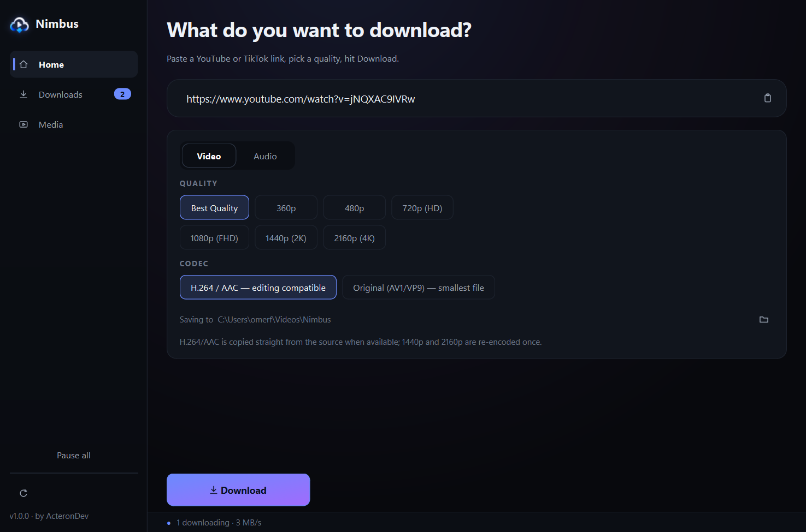

# Nimbus Downloader

A clean Windows desktop app for downloading YouTube **and TikTok** video and audio at full quality.
Built with PySide6 and yt-dlp, packaged as a portable folder — no installer, no Python needed.

> **Downloading the app?** Use the [**latest release**](../../releases/latest) and grab
> `Nimbus-<version>-win64.zip` (~108 MB). The green **Code → Download ZIP** button only
> gives you the source (~320 KB) — it does not contain the app.

**by ActeronDev**

Licensed under the [MIT License](LICENSE).



## Features

- **YouTube and TikTok** links, with an in-app player that handles VP9 / AV1 / H.265 / opus
- **Video or audio** from a single link
- **Codec choice** — `H.264 / AAC` (the pair every editor imports: Premiere, Resolve,
  After Effects) or `Original (AV1/VP9)` for the smallest file
- **Visible quality chips** on YouTube: Best Quality / 360p / 480p / 720p (HD) / 1080p (FHD) / 1440p (2K) / 2160p (4K);
  single-format sites like TikTok collapse to Best Quality
- **Parallel downloads** with pause, resume, retry and cancel, live speed and ETA
- **Media library** with list and grid views, search, thumbnails, and delete that removes the file from disk
- **Link preview** — title, channel, duration and thumbnail before you download
- Dark layered UI with a blue→violet accent, toast notifications and keyboard shortcuts
  (Space to play/pause, Esc to go back)

## Download

Grab the latest `Nimbus-<version>-win64.zip` from [Releases](../../releases), extract it
anywhere, run `Nimbus.exe`. `Create Desktop Shortcut.cmd` puts a shortcut on your desktop.

Windows 10/11, 64-bit. If Windows shows "unknown publisher" on first launch, choose
**More info → Run anyway** (the exe is unsigned).

## How it works

| Layer | Choice |
|---|---|
| Download engine | `yt-dlp` as a library (same process, so progress is exact) |
| Media | bundled `ffmpeg` — stream copy for H.264/AAC; 1440p/2160p H.264 is re-encoded once |
| UI | PySide6 (Qt 6), theme tokens in `theme.py`, vector icons drawn in code |
| Packaging | PyInstaller `--onedir` |

The app talks to YouTube through yt-dlp's extractors; when YouTube changes something,
the **Update** button in the sidebar refreshes yt-dlp without touching the app.

## Build from source

```bash
python -m venv .venv
.venv/Scripts/pip install -r requirements.txt
python fetch_vendor.py          # downloads ffmpeg + QuickJS into vendor/
pyinstaller --noconfirm --clean --windowed --name Nimbus --onedir \
  --collect-all yt_dlp --collect-all curl_cffi --version-file version_info.txt --icon assets/nimbus.ico \
  --add-data "vendor/ffmpeg/ffmpeg.exe;vendor/ffmpeg" \
  --add-data "vendor/js/qjs.exe;vendor/js" \
  --add-data "assets/mark.png;assets" --add-data "assets/nimbus.ico;assets" run.py
```

`Nimbus.exe --selftest <url> [video|audio] [quality] [h264|original]` runs a headless
download and writes the result to `%APPDATA%\Nimbus\selftest.json`.

## Project layout

```
nimbus/config.py      paths, settings, version
nimbus/downloader.py  job queue, yt-dlp engine, pause/resume/cancel, H.264 fallback
nimbus/ui.py          sidebar app: Home / Downloads / Media / Player, cards
nimbus/theme.py       colours, spacing, durations and the one global stylesheet
nimbus/widgets.py     badge, live progress, toasts, status bar, empty states
nimbus/icons.py       QPainter-drawn icon set
nimbus/update.py      yt-dlp updater
assets/               logo, icon, screenshot
```

## Notes

- The app downloads content you are allowed to download. Respect YouTube's Terms of
  Service and the rights of the content owner; redistribution is on you.
- Data lives in `%APPDATA%\Nimbus` (queue, settings, thumbnail cache).
